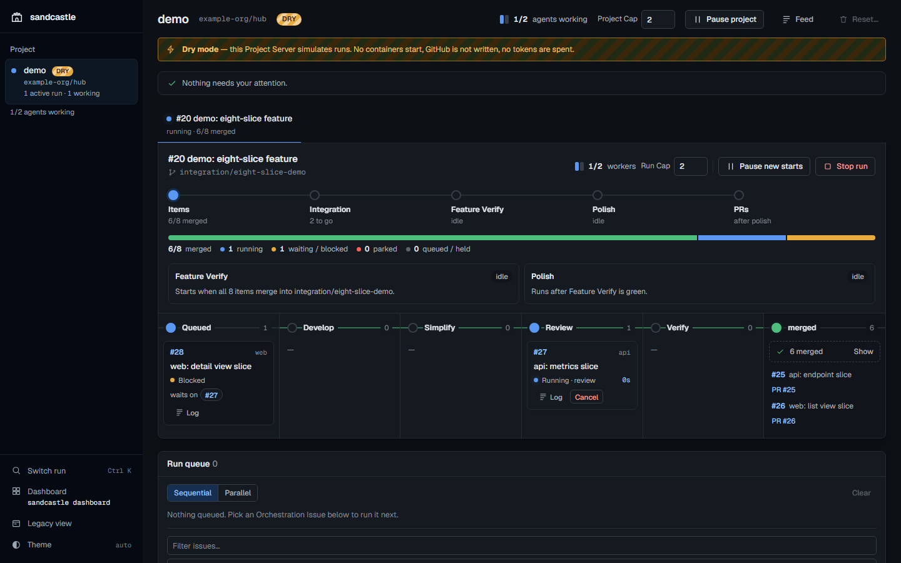
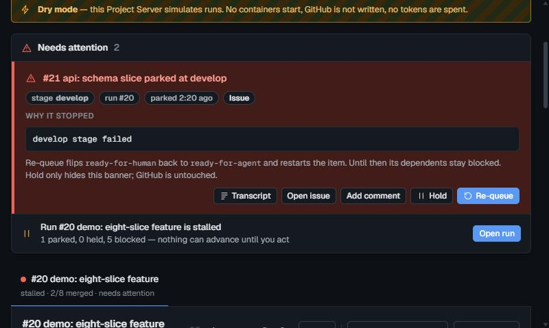

# sandcastle-orchestrator

Issue-driven multi-agent orchestrator. GitHub sub-issues in, verified integration pull requests out.

You publish one **Orchestration Issue** whose native sub-issues are the work. Each sub-issue runs through a chain of fresh Claude Code agents in throwaway Docker containers and is squash-merged into an integration branch. The assembled feature is then verified, and one `integration/<feature> -> dev` pull request per repo waits for a human to merge.



A Run held on rejected agent credentials shows an **auth Hold banner** at the top of the Board View and the Dashboard (and on the Project card): what happened, the fix per agent provider in use (claude: `claude /login`, or `claude setup-token` plus `CLAUDE_CODE_OAUTH_TOKEN` in `.sandcastle/.env.orchestrator`; codex: `codex login`, or `CODEX_API_KEY`), and an **I re-logged in, check now** button. It runs the same probe as `sandcastle preflight` right away: on success the Hold lifts and waiting items resume (parked ones are left alone); on failure the Hold stays and the probe error shows under the banner. A rate-limit Hold only shows its `until` in a neutral info row and resumes itself.

A parked item shows a **needs-human banner**: why it stopped, the stage, links to the issue and PR, and buttons to open the transcript, add a GitHub comment, hold, or re-queue (each confirms first). New parks also raise a toast, an optional desktop notification and a `(n)` count in the tab title.



Try it with no tokens: `sandcastle ui examples/demo/demo-run.json --config=examples/demo --fail=21:develop`, then open the printed URL.

## How it works

```
sub-issue -> develop -> simplify -> review -> verify gate -> squash-merge into integration/<feature>
             (one sandboxed agent per stage; rework rounds on red; park for a human when stuck)

all items done -> Feature Verify -> polish -> PR integration/<feature> -> dev
```

| Part | What it does |
|---|---|
| Scheduler | Items run as a DAG of native *blocked-by* edges under a worker cap, deepest stage first. |
| Stage chain | develop (test-first), simplify, review, verify gate (rebase, checks, squash-merge). Each stage is a fresh agent. Custom agent and command stages can be added in config. |
| Rework | A red gate, a red command stage or `NEEDS-REWORK:` from review or a custom agent stage sends the item back to develop with a written brief, up to a limit. Then it parks. |
| Park and hold | `ready-for-agent` admits an item; without it the item is held. Parked items get `ready-for-human`. Flipping the label back resumes from the failed stage. |
| Crash-resume | `sc:*` labels and pull-request markers are the durable state. A restart resumes every item where it was. |
| Sandbox | One container per stage, sanitized `.env`, read-only Claude home, idle timeout with a salvage pass, startup cleanup of orphans. |
| Feature Verify | After every item merged, a fresh agent checks the assembled feature against every acceptance criterion. Red results get fix rounds. |
| Polish | A final simplify, review and comment-strip pass on each integration pull request. |
| Control plane | Local Board View (Express + SSE): Needs Attention, a board per run with project stages, Phase Clock and Quiet, cap, pause, cancel, retry, comment, reset, a run queue, parallel parents. The original page stays at `/legacy`. |
| Operator CLI | Run commands print one JSON object each, so an agent or a person can launch, watch and finish runs without the UI. |

The hub repo (where issues live) and the code repos can be one repository or several.

## Requirements

| Tool | Notes |
|---|---|
| Node.js 20.11+ and npm | |
| Docker | Docker Desktop on Windows and macOS |
| [GitHub CLI](https://cli.github.com/) `gh` | Logged in (`gh auth login`) with write access to the hub repo's issues |
| An agent CLI login | [Claude Code](https://docs.claude.com/en/docs/claude-code) (default) and/or [Codex CLI](https://github.com/openai/codex), logged in with your subscription or an API key. See [Agent providers](#agent-providers) and [Agent login](#agent-login). |
| Agent skills | Shipped in this repo, installed into `~/.claude` by `sandcastle init`, see [Agent skills](#agent-skills) |

## Quick start

Zero to a run. Needs the [requirements](#requirements) above.

```bash
# 1. once per machine
git clone https://github.com/nivnoiman/sandcastle-orchestrator.git && cd sandcastle-orchestrator
npm ci && npm link                    # npm link gives you the global `sandcastle` command
npm run build-image                  # Docker image sandcastle:latest

# 2. once per project, from its root
cd ~/src/my-app
sandcastle init                       # or: sandcastle init --hub=owner/name --port=7781
```

| Step | Result |
|---|---|
| `npm ci` | Dependencies |
| `npm link` | A global `sandcastle` command |
| `npm run build-image` | Docker image `sandcastle:latest` (node 20, gh, claude, codex, pnpm, yarn, Playwright) |
| `init` | `.sandcastle/` in the project, and the shipped [agent skills](#agent-skills) installed into `~/.claude` |

`init` detects the hub repo (`gh repo view`, then the `origin` remote), the package manager and the `typecheck`, `test` and `build` scripts. It picks the first free port from 7777.

3. Tokens: put a fine-grained `GH_TOKEN` in `.sandcastle/.env.orchestrator`, and safe dev values in `.sandcastle/.env.sandbox` (an empty file is fine). Log in the agent CLI ([Agent login](#agent-login)).
4. Review `bootstrap` and `checks` in `.sandcastle/config.json`, then commit it and `.sandcastle/.gitignore`.
5. Start the dashboard: `sandcastle dashboard --detach`
6. Publish an Orchestration Issue (see [Publish contract](#publish-contract)), then ask your agent: **"run sandcastle on #N"**. The `sandcastle-run` skill (the Orchestrator Agent) starts the dashboard, validates, preflights, launches, opens the Board View, watches and reports.

Or drive it by hand:

```bash
sandcastle validate 12                # parse the issue tree, print the run model or every violation
sandcastle preflight 12               # every start-time check, no lock, no tokens
sandcastle launch 12 --cap=2          # start the control plane and the run
sandcastle status                     # watch it
sandcastle finish                     # assert done, print the integration pull requests
```

`npm test` runs the suite. It needs no Docker, `gh` or tokens. To try the scheduler with no setup, from the clone:

```bash
sandcastle dry-run examples/demo/demo-run.json --cap=2 --config=examples/demo
sandcastle ui examples/demo/demo-run.json --config=examples/demo
```

Without `npm link`, run commands as `npm --prefix <sandcastle clone> run <script> -- <args>` (run-operating commands: `npm --prefix <sandcastle clone> run ops -- <command>`). `init` always targets the directory it is run from, so it ignores `--config`.

## Configuration

The project is found by walking up from the current directory to the first `.sandcastle/config.json`. `--config=<path>` or `SANDCASTLE_CONFIG` override that and accept the config file, the `.sandcastle` folder or the project root. Relative paths in the config resolve against the project root.

Single repo, as `init` writes it:

```json
{
  "hubRepo": "your-name/your-app",
  "integrationBase": "dev",
  "repos": {
    "your-app": {
      "github": "your-name/your-app",
      "bootstrap": "pnpm install --frozen-lockfile",
      "checks": "pnpm typecheck && pnpm test && pnpm build"
    }
  },
  "verify": { "strategy": "command" },
  "ui": { "port": 7777 }
}
```

A multi-repo example with a compose verify environment is in [`examples/demo/.sandcastle/config.json`](examples/demo/.sandcastle/config.json).

| Field | Default | Meaning |
|---|---|---|
| `name` | repo part of `hubRepo` | Project name, lower-case kebab. Namespaces worktrees and Docker objects (`sc-<name>-...`). |
| `hubRepo` | required | `owner/name` holding the Orchestration Issue and its sub-issues |
| `integrationBase` | `dev` | Branch `integration/<feature>` is cut from and its pull requests target |
| `imageTag` | `sandcastle:latest` | Agent image |
| `memoryProject` | derived from the project root | `~/.claude/projects/<this>/memory` holds `load_bearing_memories` |
| `stateDir` | `<project>/.sandcastle` | Env files, logs, lock, queue, `ui-<parent>.log` |
| `repos.<name>.github` | required | `owner/name`. `<name>` is what the `repo:<name>` label says. |
| `repos.<name>.path` | `.` for the hub repo, else `../<name>` | Local checkout, relative to the project root |
| `repos.<name>.bootstrap` | none | Runs in every agent container before work (`npm ci`, `pnpm install ...`) |
| `repos.<name>.checks` | required | The per-item gate. Must be green before an item merges. |
| `verify` | `{ "strategy": "none" }` | Feature Verify strategy, see below |
| `ui.port` | `7777` | Control plane port for this project |
| `agents` | `{ "default": "claude" }` | Which agent CLI runs each stage, see [Agent providers](#agent-providers) |
| `stages` | `["develop", "simplify", "review", "verify"]` | The per-item stage chain, see [Stages](#stages) |

Port precedence: `--port=N`, then `SANDCASTLE_UI_PORT`, then `ui.port`, then `7777`.

### Agent providers

Every agent stage runs one agent CLI. `agents.default` picks it for all stages, and a role key overrides one stage:

```json
"agents": {
  "default": "claude",
  "review": "codex",
  "polish": { "provider": "codex", "model": "gpt-5.5-codex" }
}
```

| Provider | CLI | Subscription login | API key |
|---|---|---|---|
| `claude` (default) | Claude Code | `~/.claude` login or `CLAUDE_CODE_OAUTH_TOKEN` | `ANTHROPIC_API_KEY` |
| `codex` | OpenAI Codex CLI | `~/.codex/auth.json` from `codex login` (ChatGPT account) | `CODEX_API_KEY` (or `OPENAI_API_KEY`) |

- Roles: `develop`, `simplify`, `review`, `resolve`, `feature-verify`, `feature-fix`, `polish`. Salvage runs under its stage's role.
- A value is a provider name or `{ "provider": ..., "model": ... }`.
- Models: `model` from the entry first. Otherwise claude keeps `SANDCASTLE_MODEL` (develop, resolve, feature-fix; default `opus`) and `SANDCASTLE_REVIEW_MODEL` (the rest; default `sonnet`). Codex without a `model` uses its own default.
- Skills are the same files for every provider (see [Agent skills](#agent-skills)). Claude invokes them as skills. Codex reads them by path and also finds them in `~/.agents/skills`. Codex has no `Skill` tool or subagents, so polish tells it to run the `/polish` passes itself, in order.
- Auth holds and re-probes cover every provider in use. One rejected login holds new stages for the whole run.
- `sandcastle smoke --agent=codex` checks the codex install, home and flags in a container. It makes a real call only when a Codex login or `CODEX_API_KEY` is present.

> **Status:** `claude` is the tested path. `codex` is unit-tested and smoke-checked up to the CLI, but it has **not** been run end to end on a ChatGPT subscription or an OpenAI API key yet. Gemini CLI fits the same interface but is not built.

### Stages

`stages` lists the per-item chain in order. Leave it out to keep the default chain. Add a custom stage by inserting an entry where it should run:

```json
"stages": [
  "develop",
  "simplify",
  "review",
  { "name": "security", "kind": "agent", "prompt": ".sandcastle/prompts/security.md", "provider": "codex", "model": "gpt-5.5-codex" },
  { "name": "e2e", "kind": "command", "run": { "web": "pnpm playwright test" } },
  "verify"
]
```

- Built-in stages are the strings `develop`, `simplify`, `review` and `verify`. `develop` must come first. `verify` must come last, and is appended when left out. `simplify` and `review` can be dropped.
- Custom stage names are lower-case kebab, at most 30 characters, unique, and not a built-in or reserved word. Each one gets its own `sc:<name>` label, created on the hub the first time it is used.
- Order is the position in the list. A failure at any stage that asks for rework sends the item back to develop, and the whole chain runs again. `SANDCASTLE_REWORK_LIMIT` (default 3) caps rework rounds per item across all stages.

| Kind | Fields | What it does |
|---|---|---|
| `agent` | `prompt` (required, a file relative to the project root), `provider`, `model` | A fresh container and agent, like review. Your prompt file is the method; sandcastle wraps it with the issue spec, required reading, memories and the stage contract. The agent commits fixes as `fix(<name>):` and appends a `<!-- sandcastle:<name> -->` section to the pull request. `NEEDS-REWORK:` in that section sends the item back to develop, and `UNFIXABLE:` parks it. |
| `command` | `run` (required): one command, or a map of repo name to command | Bootstraps a clean copy of the item branch in a fresh container and runs the command. Green appends a `<!-- sandcastle:<name> -->` section to the pull request. Red sends the item back to develop with the command output as the brief. A repo missing from a `run` map skips the stage for that repo. |

- Prompt files can use `{{issue}}`, `{{issueNumber}}`, `{{title}}`, `{{repo}}`, `{{branch}}`, `{{integrationBranch}}`, `{{feature}}`, `{{stage}}` and `{{round}}`. An unknown placeholder is a config error. The file is read again at every stage start, so edits apply to the next run of the stage.
- `provider` and `model` take the same values as [Agent providers](#agent-providers). Without them the stage uses `agents.default`, with `SANDCASTLE_REVIEW_MODEL` for claude. Put them on the stage entry, not under `agents`.
- Command stages do not rebase the branch first. The verify gate still rebases and runs `checks` before any merge.
- Crash-resume places an item at a custom stage from its `sc:<name>` label, or from the pull-request sections. If a label names a stage the config no longer has, sandcastle warns and places the item from its pull request.

### Feature Verify strategies

| `verify.strategy` | What runs once every item merged |
|---|---|
| `none` | Nothing. The report says only the per-item gates ran. The integration pull request still opens. |
| `command` | One throwaway container with a fresh copy of each involved repo's integration branch: `bootstrap`, then `verify.commands.<repo>` (default: its `checks`). Red: fix rounds. Green: a fresh agent checks every acceptance criterion against the built code (Playwright and Chromium are in the image). `"agent": false` skips the agent; the green commands are the report. |
| `compose` | A throwaway Docker network with an optional fresh `mongo` (`"mongo": true` or an image) and every repo built and served (`services.<repo>`: `build`, `seed`, `serve`, `port`, `healthPath`, `env`). `env` values expand `{{port}}`, `{{mongoUri}}`, `{{mongoDb}}`, `{{url:<repo>}}`. The agent drives APIs over HTTP and UIs with Playwright. Scenarios that need a provider in `externalProviders` are marked `REQUIRES-STG` for a human. Every mongo URI in the env must point at the local container or verify refuses to start. |

## Files in `.sandcastle/`

| File | Committed | Purpose |
|---|---|---|
| `config.json` | yes | Project config |
| `.gitignore` | yes | `*`, `!.gitignore`, `!config.json`. Everything else stays local. |
| `.env.orchestrator` | no | sandcastle's own secrets (`GH_TOKEN`, optional `CLAUDE_CODE_OAUTH_TOKEN`, `ANTHROPIC_API_KEY`, `CODEX_API_KEY`, overrides). Read by the host only, never visible to agents. |
| `.env.sandbox` | no | Your app's env, copied into each agent worktree as `.env`. Agents can read it. `.env.sandbox.<repo>` overrides it for one repo. |
| `logs/` | no | Attempt transcripts and saved leftovers |
| `.orchestrator.lock` | no | Held while a run is live |
| `.queue.json` | no | Run queue and its settings |
| `ui-<parent>.log` | no | Control plane log written by `launch` |

A shared `.env.orchestrator` in the sandcastle clone is read first; the project's own file wins on a clash. Use it to share one `GH_TOKEN` across projects.

Agent worktrees live outside the repo, in `~/.sandcastle/worktrees/<project>/<repo>/<branch>`. `SANDCASTLE_WORKTREE_DIR` overrides the base folder.

`GH_TOKEN` is a fine-grained PAT with *contents* and *pull requests* write on every repo under `repos`. Agents push and open pull requests with it. Labels and comments use the host's `gh auth`.

**Migrating from the old layout:** state that lived in `<sandcastle clone>/projects/<name>/` moves into `<project>/.sandcastle/`. Alternatively set `stateDir` to the old folder.

## Publish contract

A run is defined entirely on GitHub.

**Parent (Orchestration Issue)** on `hubRepo`: label `sandcastle`, and exactly one yaml fence with a `sandcastle:` key:

```yaml
sandcastle: v1
feature: my-feature                # kebab slug: integration/my-feature, feat/<n>-<slug>
required_reading:                  # repo-relative paths every agent reads first
  app:
    - CLAUDE.md
    - docs/architecture.md
load_bearing_memories:             # optional slugs from the project's Claude memory dir
  - feedback_no_code_comments
```

**Work Items** are native sub-issues of the parent:

- Exactly one `repo:<name>` label naming a repo from the config. Split cross-repo work into two items joined by a blocking edge.
- Native *blocked-by* edges between siblings. A `## Blocked by` section with `#<n>` refs is the fallback only when the API is unavailable. An edge to a closed sibling is satisfied.
- With `ready-for-agent` the item is queued; without it the item is held. Parked items get `ready-for-human`.
- Body: `## What to build` and an `## Acceptance criteria` checklist (review and verify measure against it). Optional yaml fence `extra_memories: [<slug>]`.

**Labels** (create once on the hub):

| Label | Set by |
|---|---|
| `sandcastle` | You, on the parent |
| `repo:<name>` | You, one per repo |
| `ready-for-agent`, `ready-for-human` | You, and the orchestrator on park |
| `sc:queued` `sc:blocked` `sc:developing` `sc:simplifying` `sc:in-review` `sc:verifying` `sc:done` `sc:needs-human` | The orchestrator only. Never set these by hand: crash-resume reads them. |
| `sc:<name>` per custom stage | The orchestrator only, created on demand. See [Stages](#stages). |

`sandcastle validate` enforces all of it and names the offending issue for every violation: version `v1`, slug format, `required_reading` keys within the repos used, one known `repo:` label per item, sibling-only edges, no cycles.

## Commands

`<parent>` is the Orchestration Issue number. Every command except `init` accepts `--config=<path>`; from inside the project it is not needed. Inside a project, run a command without arguments to print its usage.

**Project**

| Command | What it does |
|---|---|
| `sandcastle init [--hub=owner/name] [--port=N]` | Create `.sandcastle/` in the current directory |
| `sandcastle validate <parent> [owner/repo]` | Parse and print the run model, or every violation |
| `sandcastle dry-run <parent \| fixture.json> [--cap=N]` | Simulate scheduling with fake adapters (no tokens) |
| `sandcastle preflight <parent> [--skip-verify]` | Every start-time check, no lock, no tokens |
| `sandcastle ui <parent \| fixture.json> [--cap=N] [--port=N] [--dry] [--fail=<item>:<stage>]` | Control plane in the browser. `--dry` simulates that parent. No argument starts an Idle Project Server (real mode; pick the parent in the UI). Running servers register in `~/.sandcastle/instances.json`. |
| `sandcastle dashboard [--detach] [--open] [--port=N]` | Multi-project dashboard on `127.0.0.1:7700`. Lists Known Projects from the registry, proxies each running Project Server (state, live events, actions), starts a stopped one (idle, real mode), and pauses every project at once. `--detach` backgrounds it and a repeated call reuses it; `--open` opens the browser on the project you are in. |
| `sandcastle start <parent> [--cap=N] [--skip-verify]` | Headless real run (spends tokens) |
| `sandcastle reset <parent> [--apply]` | Clear a killed run's containers, worktrees and labels. Prints the plan without `--apply`. |
| `sandcastle smoke [repo] [--agent=claude\|codex]` | Container, git plumbing and agent-home check. Non-billed, except a codex smoke with a login makes one tiny call. |
| `sandcastle skills install [--check] [--force]` | Install the shipped skills and commands into `~/.claude` |
| `sandcastle skills update-vendor` | Re-fetch the vendored mattpocock/skills |
| `sandcastle sync-claude <source ~/.claude>` | Copy skills, memories and credentials into the agent home |

**Operating a run** (JSON out; also available as `sandcastle ops <command>`)

| Command | What it does |
|---|---|
| `sandcastle launch <parent>... [--cap=N] [--parallel=N \| --sequential] [--global-cap=N]` | Start the control plane if it is down, start the first parent, queue the rest |
| `sandcastle enqueue <parent>... [--cap=N]` | Queue parents behind the runs in flight |
| `sandcastle dequeue <parent>` | Drop a parent from the queue |
| `sandcastle queue-mode sequential\|parallel [--max=N]` | One parent at a time, or up to N at once |
| `sandcastle queue-resume`, `sandcastle queue-clear` | Resume a paused queue, or empty it |
| `sandcastle queue` | Queue settings, queued parents, runs on the control plane |
| `sandcastle cap <N> [--parent=N]` | One run's worker cap, or the global cap without `--parent` |
| `sandcastle pause`, `sandcastle resume [--parent=N]` | Hold or release new stage starts |
| `sandcastle stop <parent>` | No new stages start for that run |
| `sandcastle status [--parent=N] [--items]` | One run: phases, holds, waiting reasons, parks, feed, queue |
| `sandcastle status --summary` | Queue, global slots, one line per run |
| `sandcastle logs <item> [stage] [--bytes=N]` | Tail the newest recorded attempt for an item |
| `sandcastle recheck-auth [--parent=N]` | After a re-login: probe the agent credentials now and lift the auth Hold if they work |
| `sandcastle resume-parked [--parent=N] [--only=<text>]` | Retry every parked item whose reason contains `<text>` |
| `sandcastle resolve-conflict <item> [--parent=N]` | Retry one parked item. The gate re-runs and may resolve it with an agent. |
| `sandcastle finish [--parent=N]` | Assert the run is complete and print its integration pull requests |

`--parent=N` may be left out while only one run exists or only one parent is live.

## Running several projects

Each project has its own state folder, lock, queue, worktree folder and Docker names (`sc-<project>-...`). Give each project its own `ui.port` (`init` picks a free one) and they run side by side:

```bash
cd ~/src/app-one && sandcastle launch 12 --cap=2      # ui.port 7777
cd ~/src/app-two && sandcastle launch 40 --cap=1      # ui.port 7778
```

Within one project, one control plane runs several parents: pass several to `launch`, or use `enqueue`, `--parallel=N` and `--global-cap=N`. See [Parallel parents](docs/internals.md#parallel-parents).

## Operating a run

`launch` starts the control plane under a supervisor that restarts it on a crash and resumes from labels. It logs to `.sandcastle/ui-<parent>.log`.

| State in `status` | Meaning | Action |
|---|---|---|
| `running`, `awaiting` | Normal | None |
| `waiting` | Usage window or credential probe | None. It resumes itself. Do not retry it. |
| `held` | No `ready-for-agent` | A human adds the label or does the item |
| `parked` | Needs a decision | Read `logs <item>`, then `resolve-conflict`, `resume-parked`, or report it |

`finish` refuses to call a run green while waiting or parked items remain, or when Feature Verify was red.

Hard rules when you step in by hand:

- Never kill the UI process mid-stage. Crash-resume re-runs whole stages.
- Never rebase a worktree whose container is up.
- Push with `--force-with-lease` only.
- Resolve conflicts in `~/.sandcastle/worktrees/<project>/<repo>/<branch>`, never in your working checkout.
- Integration pull requests are merged by a human.

## Agent login

Log in every provider you use in `agents`, one way each:

| Provider | Method | Setup | Billing |
|---|---|---|---|
| claude | Host login (default) | Log in to Claude Code on the host. `~/.claude/.credentials.json` is mounted read-only into each container. Works on Windows and Linux. | Your Claude subscription |
| claude | OAuth token | Run `claude setup-token` and set `CLAUDE_CODE_OAUTH_TOKEN` in `.sandcastle/.env.orchestrator`. Needed on macOS, where the login lives in the Keychain. | Your Claude subscription |
| claude | API key | Set `ANTHROPIC_API_KEY` in `.sandcastle/.env.orchestrator`. | Anthropic API usage |
| codex | Host login | Run `codex login` on the host (set `cli_auth_credentials_store = "file"` in `~/.codex/config.toml` if your OS keyring holds it). `~/.codex/auth.json` is mounted read-only and copied into each container. `SANDCASTLE_CODEX_HOME` points elsewhere. | Your ChatGPT subscription |
| codex | API key | Set `CODEX_API_KEY` (or `OPENAI_API_KEY`) in `.sandcastle/.env.orchestrator`. | OpenAI API usage |

With a subscription, a spent usage window shows items as **waiting**; they resume when the window resets. `sandcastle preflight` checks that a throwaway container can reach every provider in use with whichever login is configured.

**Codex token refresh.** Codex rotates its ChatGPT refresh token when it refreshes, roughly every 8 days, and a reused token logs every copy out. So sandcastle refreshes a login that is close to expiry once, through the probe, before the stage starts. When a container refreshes anyway, sandcastle writes the new `auth.json` back to the host, unless the host file changed in the meantime. With many parallel codex stages, `CODEX_API_KEY` avoids the question entirely.

## Lessons from real runs

- **Run CI on the integration branch from the start.** Per-item verify only proves each item on its own. Land the CI workflow first (give `GH_TOKEN` the `workflow` scope, or an agent cannot push `.github/workflows`) and require it on pull requests into `integration/<feature>`. Otherwise settings that only break the assembled feature, like a server default that rejects long signed links, surface at Feature Verify or later.
- **Pin server limits in tests.** Test the longest legal token or path and an empty body with a JSON content type, so behavior never depends on framework defaults.
- **Do not write to the shared `.git` while stages run.** `git worktree add -b`, `git branch` and `git push -u` add `branch.*` entries to `.git/config`, and the git guard parks the running item as "changed config under .git". Work in a separate clone, and push without `-u`.
- **After a login or token fix, press the banner button or run `sandcastle recheck-auth`.** The auth Hold re-probes on its own only every 10 minutes, so it can outlast a working login by up to that long. The button and `recheck-auth` probe at once and lift the Hold on success.
- **Network blips park items.** A stage that fails on a registry timeout (for example corepack fetching pnpm) is safe to retry with `resume-parked --only="<stage> stage failed"`.
- **Pin the package manager version in the repo.** The image runs `pnpm@latest` for itself, but the project uses the version in `packageManager`. Bump it on purpose, with a lockfile refresh and any build-script allow list the new major needs, not mid-run.

## Security model

Agents run their CLI with every approval and CLI sandbox switched off inside their containers: Claude Code with `--dangerously-skip-permissions`, Codex with `--dangerously-bypass-approvals-and-sandbox`. The Docker container is the sandbox. Agents read the issue text you label and hold real credentials. Treat that as the trust boundary.

- **Only label issues written by people you trust.** Issue bodies reach the agents verbatim. A hostile body is a prompt injection into an agent that can push code. Comments are not read.
- **`GH_TOKEN` is a fine-grained PAT** scoped to exactly the repos under `repos`, with contents and pull requests write and nothing else. Never a classic token, never org-wide.
- **Agents see the credentials of their own provider, and only those.** A claude container gets a read-only mount of `~/.claude`, copied into the container, plus `CLAUDE_CODE_OAUTH_TOKEN` / `ANTHROPIC_API_KEY`. A codex container gets `~/.codex` (`auth.json`, `AGENTS.md`), the shared `~/.claude/skills` and `~/.claude/commands`, and `CODEX_API_KEY`. It never sees the Claude login, and a claude container never sees Codex's. Use a dedicated `claude setup-token` token or an API key with a spend limit if that matters to you.
- **A refreshed Codex login is written back to the host.** This is the one path where a container's output reaches a host credential file. sandcastle accepts it only if it parses as JSON and the host file is unchanged since the container started.
- **Containers have network access** (npm, GitHub, Anthropic, OpenAI). There is no egress filter.
- **The host is guarded against the shared `.git`.** Each container mounts the repo's `.git` so it can commit. Host git runs with hooks and fsmonitor disabled, and the orchestrator refuses a stage (restoring the file) if a container changed `.git/config` or `.git/info/attributes`.
- **`.env.sandbox` is readable by agents.** Put only throwaway dev values there.
- **`.env.orchestrator` never reaches a container.** The host reads it; it is gitignored.
- **The control plane** listens on `127.0.0.1` only, checks the `Host` header and requires an `x-sandcastle: 1` header on every write.

## Agent skills

The stage prompts and the Orchestrator Agent invoke skills that must exist in the host `~/.claude`, whichever provider runs the stage. They ship in this repo and `sandcastle init` installs them; preflight checks them with `sandcastle skills install --check` and names the fix.

| Source in this repo | Installed to | Used by |
|---|---|---|
| `skills/vendor/mattpocock/{tdd,to-spec,to-tickets}` | `~/.claude/skills/` | develop and rework (`tdd`); planning |
| `skills/simplify` | `~/.claude/skills/simplify` | simplify stage |
| `skills/mat-review` | `~/.claude/skills/mat-review` | review stage (standards and spec) |
| `commands/polish.md`, `commands/review.md` | `~/.claude/commands/` | polish stage |
| `skills/sandcastle-run`, `commands/sandcastle-run.md` | `~/.claude/` | "run sandcastle on #12" or `/sandcastle-run 12` |

```bash
sandcastle skills install             # copy them; locally modified copies are skipped
sandcastle skills install --force     # overwrite those too
sandcastle skills install --check     # change nothing; exit 1 if any is missing or outdated
sandcastle skills update-vendor       # re-fetch mattpocock/skills (MIT) at upstream HEAD
```

A copy counts as modified when it differs from both the repo and what the last install wrote (recorded in `~/.claude/.sandcastle-installed.json`). Re-run `install` after `git pull` to pick up updates. The vendored skills are pinned to the commit in [`skills/vendor/mattpocock/SOURCE`](skills/vendor/mattpocock/SOURCE) and change only through `update-vendor`. Any skill with the same name and contract works: apply fixes since a fixed point; review a diff against standards and the issue.

## Documentation

[`docs/internals.md`](docs/internals.md) covers the engine, labels, preflight, rework, conflicts, sandbox hardening, salvage, prompts, the control plane API, Feature Verify, polish, parallel parents and transcripts.

## Credits

This is a side project that complements [Matt Pocock's Sandcastle](https://github.com/mattpocock/sandcastle) (npm `@ai-hero/sandcastle`). The name and the idea (agents in a sandbox, branches merged back) come from there. For a TypeScript library that orchestrates sandboxed coding agents, use Sandcastle.

sandcastle-orchestrator is not affiliated with or endorsed by the Sandcastle project. It ships its own Docker runner today. Moving the sandbox layer onto `@ai-hero/sandcastle` is on the roadmap.

## License

[MIT](LICENSE)
